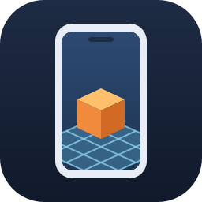

# PocketAR



PocketAR is a handheld AR GDExtension for Godot.

## Why PocketAR

- One API for ARKit on iOS and ARCore on Android, plus a simulated camera and recorded replay for building AR scenes on a Mac without a phone.
- Built on Godot's XR interface and the Mobile renderer (Metal and Vulkan), on stock Godot 4.7.2 and newer.
- iOS camera frames reach the GPU without a CPU copy.
- Tapping to place returns typed hits on detected planes, and planes keep their identity while they're tracked.
- Pause, resume, menus and permission prompts are handled, and ARCore and camera access are requested only when your game starts AR.
- Ships as a ready-to-use addon ZIP with editor documentation, tested in CI, with harnesses for real phones.

## Requirements

Use public Godot 4.7.2+ with matching export templates; no fork is required.
Editors require Apple Silicon macOS; Windows, Linux and Intel Macs are unsupported.

| Target | Requirements |
| --- | --- |
| iOS | iOS 16+, arm64, ARKit world tracking and hardware supported by Godot's Metal renderer. No simulator build. |
| Android | API 29+, arm64, an ARCore-supported device with Vulkan and Google Play Services for AR 1.48+. |
| Desktop development | macOS 13+, Apple Silicon, Mobile/Metal; synthetic camera or scripted replay, without live AR. |

OS minimums do not certify device support; iPhone 7 Plus/A10/iOS 15 is unsupported.

Set these project settings before creating an ARView:

| Setting | Value |
| --- | --- |
| `rendering/renderer/rendering_method` and `.mobile` | `mobile` |
| `rendering/rendering_device/driver.ios` and `.macos` | `metal` |
| `rendering/rendering_device/driver.android` | `vulkan` |
| `rendering/rendering_device/fallback_to_opengl3` | `false` |
| `rendering/driver/threads/thread_model` | `1` (Safe) |
| `rendering/viewport/hdr_2d` | `false` (SDR outer viewport) |
| `rendering/anti_aliasing/quality/use_debanding` | `true` for in-scene composition |
| `rendering/rendering_device/staging_buffer/block_size_kb` | `4096` for ARCore CPU uploads |
| `rendering/rendering_device/staging_buffer/texture_upload_region_size_px` | `1024` for ARCore CPU uploads |

Separate rendering threads and the Compatibility/OpenGL renderer are unsupported.
Keep the outer viewport SDR even when ARView uses an HDR virtual viewport.
PocketAR reports staging settings but never changes them; they avoid small upload
regions on Android.

Android uses CPU uploads on stock 4.7.2. Engines with
`ExternalTexture.submit_hardware_buffer` automatically try hardware buffers,
falling back to CPU if activation fails.

## Install

Download `pocketar-<version>.zip` from [Releases](https://github.com/doublesymmetry/pocketar/releases),
unzip into your project, and enable **PocketAR** in Project Settings → Plugins.
`addons/pocketar/` includes all supported debug/release binaries, shaders, `.uid`
files, editor help, license notices and the API contract in `docs/`.
`release.json` records source and dependency provenance.

For the complete sample, unzip `pocketar-tap-to-place-<version>.zip`, import
`tap_to_place/project.godot` and press Run. `SHA256SUMS` covers both ZIPs.

A git clone or GitHub's **Download ZIP** contains no compiled libraries: build
with `tools/build.sh` before opening a project, or use the release ZIPs to run
without building. The `harness/` project runs tests; `samples/tap_to_place/` is
the example game.

### Build from source

Install Nix and devenv on Apple Silicon and select Xcode with `xcode-select`.
The environment supplies SCons, Python, Java 17 and the Android SDK/NDK.

```sh
git clone --recurse-submodules https://github.com/doublesymmetry/pocketar.git
cd pocketar
devenv shell
tools/build.sh macos debug
tools/build.sh android debug  # or: tools/build.sh ios debug
```

Build the mobile target with `release` for release exports. The macOS debug
library supplies editor help and is required even for mobile-only games. Copy
all of `harness/addons/pocketar/` to your project's `addons/pocketar/` and enable the plugin.
In the repository shell, `stock godot` selects public Godot 4.7.2.

## Add an AR scene

`ARView` combines the camera, a private 3D scene and HUD. Attach this script to
a full-rect `Control`; `ARView.new()` alone lacks the packed scene's children.

```gdscript
extends Control

var ar: ARView

func _ready() -> void:
	ar = preload("res://addons/pocketar/ar_view.tscn").instantiate() as ARView
	match OS.get_name():
		"iOS": ar.backend = ARView.Backend.ARKIT
		"Android": ar.backend = ARView.Backend.ARCORE
		_: ar.backend = ARView.Backend.SYNTHETIC
	ar.composition = ARView.Composition.IN_SCENE
	ar.plane_finding_mode = PocketAR.PLANE_FINDING_HORIZONTAL_AND_VERTICAL
	ar.handle_presses = true
	ar.screen_pressed.connect(_place)
	ar.session_generation_changed.connect(_clear_placements)
	add_child(ar)
	ar.set_anchors_and_offsets_preset(Control.PRESET_FULL_RECT)
	var reset_button := Button.new()
	reset_button.text = "Reset AR"
	reset_button.pressed.connect(ar.reset)
	ar.hud.add_child(reset_button)

func _place(point: Vector2, _ray: Dictionary) -> void:
	var hits: Array[ARRaycastHit] = ar.raycast(point)
	if hits.is_empty():
		return
	var marker := MeshInstance3D.new()
	var box := BoxMesh.new()
	box.size = Vector3(0.1, 0.1, 0.1)
	marker.mesh = box
	ar.scene_root.add_child(marker)
	marker.global_transform = hits[0].pose
	marker.position += marker.basis.y * 0.05

func _clear_placements(_generation: int) -> void:
	for child: Node in ar.scene_root.get_children():
		child.queue_free()
```

Choose `backend` and `composition` before `add_child`; platform selection is
manual. Follow the [startup, coordinate and input contracts](docs/api.md#game-api).
The synthetic backend has no planes; placement needs a phone or scripted fixture.
The [tap-to-place sample](samples/tap_to_place/README.md) includes that fixture,
Start AR, session messages, reset and plane display.

## Anchors

Use one anchor for a nearby rigid group so the native SDK can correct its world
pose as tracking improves. Create it when the user taps a fresh hit, then keep
the same anchor through preview and confirmation:

```gdscript
var anchor: ARAnchorTracker
var anchor_node: XRAnchor3D

func place(hit: ARRaycastHit, content: Node3D) -> void:
	anchor = ar.create_anchor_from_hit(hit)
	if anchor == null:
		return
	anchor_node = ar.add_anchor_node(anchor)
	anchor_node.visible = anchor.tracking_state == ARAnchorTracker.TRACKING
	anchor_node.tracking_changed.connect(_tracking_changed)
	anchor_node.add_child(content)
	content.transform = Transform3D.IDENTITY

func _tracking_changed(tracked: bool) -> void:
	anchor_node.visible = tracked

func clear_anchor() -> void:
	if anchor != null:
		ar.remove_anchor(anchor)
	anchor = null
	if is_instance_valid(anchor_node):
		anchor_node.queue_free()
```

Call `clear_anchor()` before replacing this placement. Put scale, yaw and offsets on
children; the stock `XRAnchor3D` follows the anchor. Gate game input and physics
on tracking too, since hiding content does not disable them. Free-pose placement
uses `ar.create_anchor(world_pose)`.

Anchors do not persist across reset or session recreation and do not guarantee
zero drift. See the [anchor contract](docs/api.md#anchors) for platform differences,
freshness, lifecycle and ownership.

## Session cost controls

Plane discovery defaults to disabled. Use `ar.suspended` for menus; hiding or
covering the view does not pause AR. See [session controls](docs/api.md#session-controls)
for plane discovery, camera quality/rate, suspension and permission retries.

## Export

Keep the plugin enabled. Use matching debug/release binaries and export templates,
your game's identifiers and signing credentials.

### Android

- Install the Android build template from Godot's Project menu. PocketAR forces
  Gradle export and supplies its AAR and `com.google.ar:core:1.56.0`.
- Set `gradle_build/min_sdk="29"`, `gradle_build/target_sdk="36"` and enable only
  `architectures/arm64-v8a`. Configure the Android SDK and Java 17 in the editor.
- Enable `permissions/camera`; the AAR declares CAMERA. Creating an ARCore ARView
  requests installation and runtime permission; create it when entering AR.
- Leave `pocketar/ar_required=false` for AR Optional; true requires ARCore hardware
  and sets required manifest metadata.

### iOS

- Enable arm64 and set `application/min_ios_version="16.0"` or higher.
- Set `application/bundle_identifier`, your signing team and a meaningful
  `privacy/camera_usage_description` (`NSCameraUsageDescription`) for camera consent.
- `pocketar/ar_required=true` adds the `arkit` required capability; false leaves
  unsupported-device handling to the game.
- Export an Xcode project, then sign and build it in Xcode. PocketAR adds ARKit,
  Metal, CoreVideo and AVFoundation linkage; its XCFramework contains device arm64 only.

## Composition

`IN_SCENE` (default) shares a scene buffer: transparency and screen reads include
the camera at lower bandwidth. Exposure, tonemapping, grading and glow affect
camera pixels. Mobile's normalized buffer clips radiance near two. Material
debanding reduces gradient banding with small per-pixel noise. Reserve material
priority 127 for the camera; decal boxes overlapping its near-plane proxy can
paint the camera image.

`ISOLATED_CAMERA` composites an SDR camera beneath an HDR virtual scene. Camera
pixels bypass Environment effects; virtual objects retain float colour range,
at the cost of the HDR viewport and composite. Screen reads see only virtual
objects; glow at zero coverage alpha is discarded.

Both ignore Environment background mode/colour, preserve the source resource
and apply other live settings before drawing. Transparent-viewport depth-of-field
restrictions apply; custom blend modes need rendering checks.

## API and limitations

Native class help is embedded in editor/debug libraries; ARView has tooltips and
script help. See the [API contract](docs/api.md) for placement and packet lifetimes:
retaining packets does not preserve native camera pixels.

There is no depth occlusion, image/face tracking, light estimation,
cloud/geospatial anchors or persistent world map API. Live queries, Android
datasets and diagnostics are [advanced](docs/api.md#advanced-and-internal-surfaces).
Simultaneous ARViews and mixing AR sessions with Godot CameraServer feeds are unsupported.

Contributor procedures are in [AGENTS.md](AGENTS.md), with
[packaging](tools/package.py), [version synchronization](tools/version.py) and
[CI checks](tools/ci.sh) in `tools/`. The [release workflow](.github/workflows/release.yml)
checks `v<VERSION>` tags before publishing ZIPs and checksums. CI does not certify phones.

## License

PocketAR is [MIT licensed](LICENSE); godot-cpp is also MIT licensed. Apple ARKit
and Google ARCore remain subject to their own SDK/runtime terms. See
[the ARCore dependency notice](thirdparty/arcore/README.md) for provenance.
